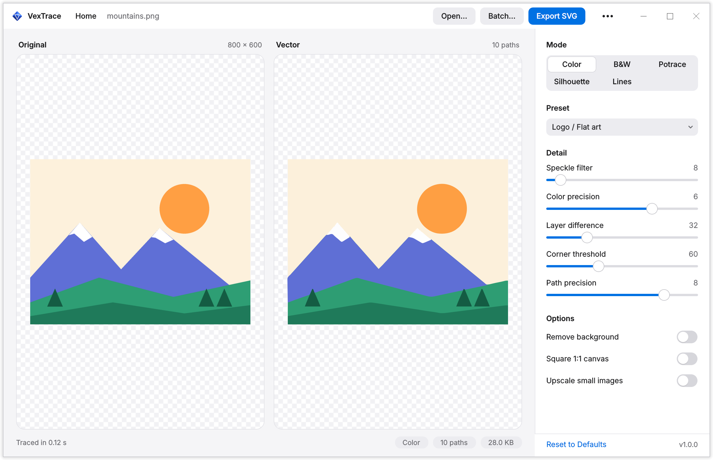
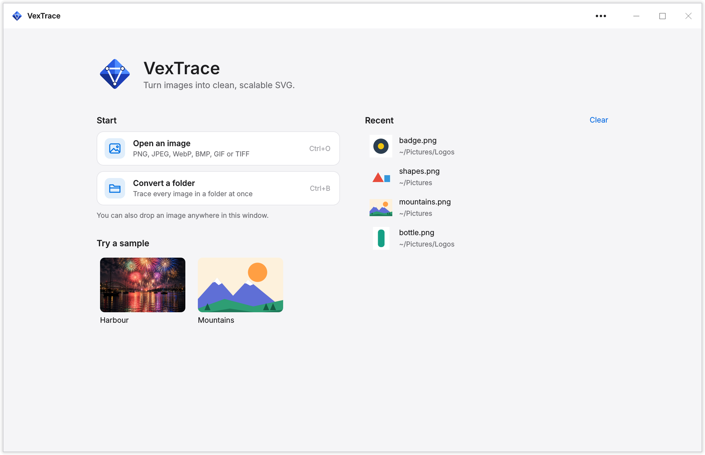
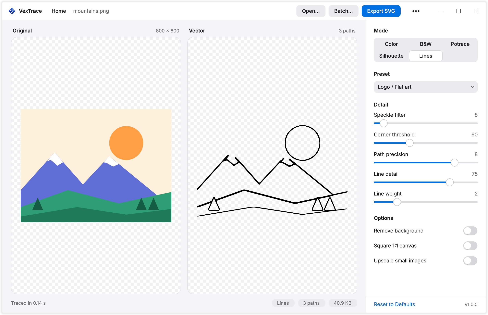

<div align="center">


# VexTrace

**Turn raster images into clean, scalable SVG.**

[](https://github.com/devbnkdr/VexTrace/actions/workflows/ci.yml)


<picture>
  <source media="(prefers-color-scheme: dark)" srcset="assets/screenshot-dark.png">
  
</picture>

</div>

---

VexTrace is a small desktop app that converts PNG, JPEG, WebP, BMP, GIF and
TIFF images into SVG vector graphics. Drop an image in, move a few sliders, and
the vector preview updates next to the original. It also has a command-line
interface for scripts and batch jobs.

It's free and open source under the MIT license.

## Features

- **Live side-by-side preview.** The traced SVG re-renders in the background as
  you move a slider, so the window never freezes.
- **Five ways to trace.** Full colour, black and white, crisp 1-bit with
  [potrace](https://potrace.sourceforge.net/), a solid **silhouette** of the
  subject, or a **line drawing** of its edges. Tracing is done by
  [vtracer](https://github.com/visioncortex/vtracer) unless you pick potrace.
- **Presets that work.** Logo, Illustration and Photo, each tuned to collapse
  flat regions into as few paths as possible.
- **Clean output.** Every SVG gets a proper `viewBox`. You can strip a solid
  background, or pad the artwork to a square canvas for icons and avatars.
- **Batch conversion.** Convert a whole folder in one go, from the GUI or the CLI.
- **Quick to try.** It comes with sample images and a short tour on first launch.
- **Fast on big images.** A quick preview appears in about a second, then the
  full-quality trace replaces it.
- **A proper app window.** VexTrace draws its own title bar and opens to a home
  page with your recent images. The layout adapts to small windows. The light and dark themes follow your system,
  and the installer adds a desktop entry and file-manager integration.

## Install

### Arch / CachyOS

```sh
git clone https://github.com/devbnkdr/VexTrace.git
cd VexTrace
./install.sh
```

The installer:

1. installs `python`, `python-pyqt6` and `potrace` with pacman (it will ask for
   your sudo password),
2. creates a venv at `~/.local/share/vextrace/venv` with
   `--system-site-packages` and installs `vtracer` and `pillow` into it,
3. adds a `~/.local/bin/vextrace` launcher,
4. installs a `.desktop` entry and icon, so VexTrace appears in your
   application menu under **Graphics** and in Dolphin's **Open With** menu for
   images.

Nothing is installed into the system Python. Everything Python-side lives in
that venv.

If `~/.local/bin` isn't on your `PATH`, add it. For fish:

```sh
fish_add_path ~/.local/bin
```

Run `./uninstall.sh` to remove everything again. System packages are left
installed, since other software may depend on them.

### Any other Linux

Install `potrace` from your package manager if you want Potrace mode (it's
optional), then install VexTrace into a virtual environment:

```sh
git clone https://github.com/devbnkdr/VexTrace.git
cd VexTrace
python3 -m venv .venv
.venv/bin/pip install -e .
.venv/bin/vextrace
```

You need Python 3.10 or newer. Installing with `-e` keeps VexTrace running from
the cloned folder, so the app icon and sample images are found.

## Using the app



VexTrace opens to a home page. The first time, a short tour walks you through
the app using one of the samples. You can replay it from the **•••** menu with
**Show tutorial**. From the home page:

- **Open an image** with **Open an image**, by dropping it anywhere on the
  window, by picking one under **Recent**, or with <kbd>Ctrl</kbd>+<kbd>O</kbd>.
- **Try a sample**: the harbour photo and the mountains illustration come with
  the app, so you can see what each mode does before using your own images.
- **Tune the result** in the sidebar. The preview updates as you go.
- **Export** with **Export SVG** or <kbd>Ctrl</kbd>+<kbd>S</kbd>.
- **Batch convert** a folder with **Convert a folder**, **Batch…** or
  <kbd>Ctrl</kbd>+<kbd>B</kbd>.
- **Go back** to the home page with **Home** in the title bar.

The window has its own title bar, the same on every desktop: drag it to move
the window, double-click it to maximize, and use the buttons on the right to
minimize, maximize or close. Drag any edge to resize.

On large images you'll see a quick, rougher preview first, then the
full-quality trace. **Export SVG** turns on once the full trace is ready.

The footer shows the **path count** and **file size** of the current result.
It's the quickest way to tell a clean trace (tens of paths) from a messy one
(thousands).

<br clear="right">

### Modes

| Mode | Engine | Best for |
|---|---|---|
| **Color** | vtracer | Colour artwork, general use |
| **B&W** | vtracer | Quick black-and-white tracing |
| **Potrace** | potrace | Crisp 1-bit logos, line art, scanned ink |
| **Silhouette** | vtracer | The subject as one solid black shape, background removed |
| **Lines** | vtracer | A line drawing of the image's edges, like an outline sketch |

**Silhouette** treats the most common colour around the edge of the image as
the background, removes it, and fills in everything else, including holes
inside the subject. It works best when the subject sits on a plain or
transparent backdrop. On a busy photo it can't tell subject from scenery.

**Lines** finds the places where colour or brightness changes sharply and
traces them as lines of even weight. It works on any image, but flat artwork
gives the cleanest drawing. On photos, lower the line detail to keep only the
strongest edges.



### Settings

| Setting | What it does |
|---|---|
| **Speckle filter** | Discards traced patches smaller than N pixels. Raise it to clean up noise and JPEG artefacts. |
| **Color precision** | Bits of colour detail kept per channel. Lower is flatter and more poster-like. |
| **Layer difference** | Minimum colour gap between stacked layers. Higher merges similar shades into one path. |
| **Corner threshold** | Angles sharper than this stay as corners. Blunter ones are smoothed into curves. |
| **Path precision** | Decimal places kept in path data. Lower gives smaller files with slightly coarser curves. |
| **B&W threshold** | Luminance split point in Potrace mode. Pixels darker than this become ink. |
| **Background tolerance** | Silhouette mode: how far a colour can stray from the background and still count as background. |
| **Line detail** | Lines mode: higher values keep fainter edges, so you get more lines. |
| **Line weight** | Lines mode: how thick the traced lines are. |

The sidebar only shows the settings that apply to the current mode. In Potrace
mode, the shared sliders map onto potrace's own options: speckle filter →
`--turdsize`, corner threshold → `--alphamax`, path precision →
`--opttolerance`. A corner threshold of 60 matches potrace's default.

### Options

- **Remove background**: finds the most common colour around the edge of the
  image and makes it transparent, so the SVG has no background rectangle.
- **Square 1:1 canvas**: pads the artwork out to a centred square viewBox, with
  an adjustable margin, so it drops into icon and avatar slots without being
  stretched.
- **Upscale small images**: resamples anything under 512 px before tracing.

Images larger than 1600 px on the long side are scaled down before tracing, so
a 12-megapixel phone photo traces in seconds instead of minutes. The SVG still
comes out at the original image's dimensions. From the command line,
`--max-size` changes the limit, and `--max-size 0` traces at full size.

### Appearance

VexTrace follows your desktop's light or dark setting and switches live when
it changes. To force one or the other:

```sh
VEXTRACE_THEME=dark vextrace
```

## Command line

```sh
vextrace input.png                              # writes input.svg
vextrace input.png -o out.svg
vextrace logo.png -o logo.svg --preset logo
vextrace scan.png -o scan.svg --mode potrace --bw-threshold 140
vextrace product.jpg -o shape.svg --mode silhouette --bg-tolerance 40
vextrace drawing.png -o sketch.svg --mode lines --line-detail 85 --line-weight 1
vextrace art.png -o art.svg --remove-bg --square --padding 10
vextrace ./images --batch -o ./svgs --preset illustration
```

Any individual setting can override a preset:

```sh
vextrace photo.jpg --preset photo --filter-speckle 8 --path-precision 5
```

`vextrace --help` lists every flag. Run `vextrace` with no arguments to open
the GUI.

## Tips for clean results

- **Upscale small images first.** Tracing follows pixel edges, so a 64 px icon
  gives chunky, stair-stepped paths. Turn on **Upscale small images**, or enlarge
  it 4–8× beforehand.
- **Use the Logo preset for flat art.** A high layer difference stops
  near-identical shades from splitting into separate paths.
- **For pure black-and-white artwork, try Potrace.** It almost always beats
  vtracer's binary mode on logos and lettering.
- **Raise the speckle filter on JPEGs and scans.** Compression artefacts and
  paper grain otherwise turn into hundreds of stray paths.
- **Watch the path count.** If you're seeing thousands, raise the speckle filter
  and layer difference, or lower the colour precision.
- **Clean up the source.** Crop borders, and flatten gradients and drop shadows.
  Gradients are the main cause of huge, layered SVGs.
- **Photos will never be small.** The Photo preset gives a stylised, posterised
  result, not a faithful copy. That's the nature of vector tracing. It's also
  the slowest preset, so expect a few seconds per change on a photo.

## Development

```sh
python3 -m venv .venv
.venv/bin/pip install -e . pytest ruff
.venv/bin/ruff check .
.venv/bin/pytest
```

The tests include a quick run of the window itself, without showing it on
screen.

The whole app (GUI, CLI and tracing pipeline) lives in
[`vextrace.py`](vextrace.py).

> [!WARNING]
> **vtracer and Python 3.14.** vtracer 0.6.15's Python 3.14 wheel segfaults the
> interpreter if it is called with *any* keyword argument (a PyO3 bug).
> VexTrace therefore calls it with positional arguments only. Don't rewrite
> that call in keyword form. It crashes the process rather than raising an
> error.

| File | |
|---|---|
| `vextrace.py` | The app: GUI, CLI and tracing |
| `install.sh` / `uninstall.sh` | Per-user install for Arch / CachyOS |
| `tests/` | Pytest suite for the pipeline and CLI |
| `assets/` | App icon and screenshots |
| `assets/samples/` | Sample images shown on the home page |

## License

VexTrace is released under the [MIT License](LICENSE). You can use, copy,
change and share it, including commercially, as long as you keep the copyright
and license notice.

## Disclaimer

VexTrace is provided **"as is", without warranty of any kind**, express or
implied, including the warranties of merchantability, fitness for a particular
purpose and non-infringement. In no event shall the author be liable for any
claim, damages or other liability arising from the software or its use. The
[license](LICENSE) has the full terms.

In plain words:

- **Check the output before you rely on it.** Tracing is an approximation. The
  SVG can differ from the original in shape, colour and detail, so look it over
  before using it for print, signage, cutting machines or anything else where
  mistakes cost money.
- **Keep your originals.** VexTrace never changes the image you open, but it
  will replace an existing SVG if you export or convert over it.
- **You're responsible for what you trace.** Converting an image to SVG doesn't
  change who owns it. Only trace artwork, logos and photos you have the right to
  use.
- **The installer changes your system.** `install.sh` installs system packages
  with `sudo pacman` and adds files under your home folder. Read it before you
  run it.
- **No support is promised.** Bug reports and fixes are welcome, but there's no
  guarantee of updates, fixes or compatibility with future systems.
- **If something goes wrong, the author isn't liable.** That includes lost
  files, wasted materials, lost time or any other loss from using VexTrace, as
  far as the law allows.
